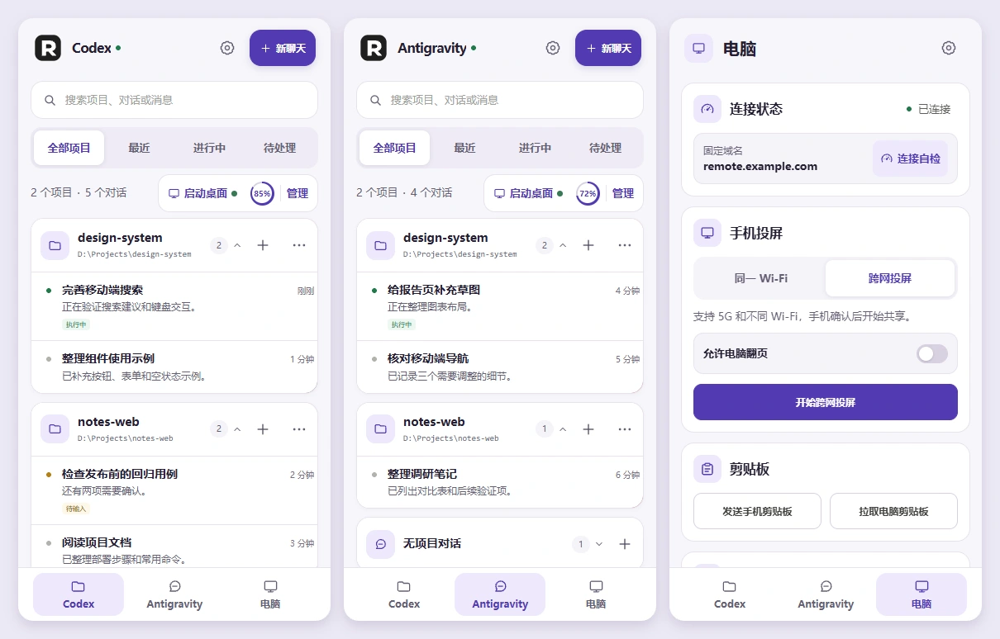

# Codex Remote for Android

[简体中文](README.md) · **English**

**Continue your Windows Codex and Antigravity sessions from Android.** Check on a task, answer a question, attach a screenshot, or start something new while you're away from your desk. Your assistants run on your PC using the accounts already signed in there.

[Download the Android APK and Windows companion](https://github.com/jujubon/codex-remote-android/releases/latest) · [Quick start](#quick-start) · [Connect remotely](#connect-remotely-with-cloudflare-tunnel)

| Tab | What you can do from your phone |
| --- | --- |
| **Codex** | Browse projects and conversations, start tasks, follow tool activity, and check usage. In supported sessions, answer questions, handle approvals, steer a running turn, or stop it. |
| **Antigravity** | Start and resume chats through the signed-in Windows CLI and check usage. Open the official Google remote panel from the desktop controls for desktop conversations. |
| **Computer** | Check the connection, share files and plain text, preview received images, lock the PC, keep it awake with the screen off, mirror your phone, and install updates. |

<p align="center">
  
</p>

## Quick start

You'll need a phone running **Android 7.0 or later** and a Windows PC with **Codex Desktop** installed and signed in.

1. **Install both packages.** Install the APK on your phone and fully extract the Windows ZIP to a permanent folder. [Downloads](https://github.com/jujubon/codex-remote-android/releases/latest)
2. **Start the companion on the same Wi-Fi.** Run `Start.cmd` from the extracted folder. The window shows your `App address` and `Pairing token`.
3. **Pair the phone.** Open Connection Settings (`连接设置`), enter those two values, and save. You can now open an existing conversation or start a new one. The app UI currently uses Simplified Chinese.

The Windows launcher uses the Node.js runtime bundled with Codex when available. If it cannot find `node.exe`, install Node.js 22.12 or later. For Antigravity CLI chats, install and sign in to Antigravity CLI on Windows. The companion starts it on demand.

## Connect remotely with Cloudflare Tunnel

The documented cross-network setup uses **Cloudflare Tunnel and a fixed HTTPS hostname**. Leave the PC awake, online, and signed in to Windows.

1. **Start tunnel mode.** Exit the foreground companion if it is running, then run `Start-Tunnel.cmd`. The companion listens at `http://127.0.0.1:8787`.
2. **Configure Cloudflare.** Add your domain to Cloudflare, create a tunnel, and follow the Windows instructions to start `cloudflared`. Add a published subdomain and set the service URL to `http://127.0.0.1:8787`. [Cloudflare Tunnel setup](https://developers.cloudflare.com/tunnel/get-started/)
3. **Use the fixed hostname on your phone.** Change the server address to your HTTPS hostname, for example `https://remote.example.com`, and keep your Codex Remote pairing token. Switch to mobile data and run a connection check from the Computer tab.

### Switch back to your local network automatically

Set your trusted Wi-Fi or hotspot to **Private** in Windows. Run `Enable-Trusted-LAN.cmd` as administrator, then restart the companion. Keep the fixed HTTPS address in the app. Once the app finds and verifies your PC on the local network, it connects directly. When you leave, it uses the fixed hostname again.

To try the local route manually, enter `http://<PC-LAN-IPv4>:18788` in the manual LAN address field. The Computer tab shows which route is in use. Hotspot connectivity depends on both devices' network settings. [Hotspots and mirroring (Chinese)](docs/phone-reader.md#手机开热点给电脑)

## Everyday use

- **Pick up a Codex task.** Search projects, conversations, and messages. Open the elapsed-time row to see a turn's tool activity. Live controls in desktop-created chats depend on the available Codex Desktop connection and the session state. [Desktop connection details (Chinese)](docs/desktop-ipc.md)
- **Launch or close a desktop app.** Tap **Launch** (`启动`) in the relevant assistant tab. Green means the window is open and amber means it is opening or closing. The **⋯** next to search opens project and conversation management. For the Antigravity desktop panel, enable Remote Control on the PC and sign in to the panel with the same Google account.
- **Send screenshots and files.** Use the Android share sheet to send a file to your PC or attach multiple files to a chat. Preview pictures in the phone inbox. Storage locations and attachment cleanup are configurable. [File transfers (Chinese)](docs/file-transfer.md)
- **See your phone on your PC.** Open phone mirroring from the Computer tab. Local mirroring uses scrcpy and wireless debugging. Android asks for permission when you start cross-network screen sharing. [Phone mirroring setup (Chinese)](docs/phone-reader.md)

## Background operation and updates

- **Start at Windows sign-in.** Run `Enable-Autostart.cmd` after pairing to run the companion as a background scheduled task. A standalone Cloudflare connector runs as its own service. A tunnel configured for Codex Remote to manage starts with the companion. Use `Disable-Autostart.cmd` to turn off the companion's sign-in launch.
- **Update Android in the app.** A cold start checks for updates quietly. When an update is available, you can install it or defer it. You can also check manually under **Computer → Version & Updates**. The app verifies the APK and Android asks you to confirm installation.
- **Update Windows from your phone.** Since 0.9.47, the background companion can download, verify, and switch to a new Windows package. If startup fails, it restores the previous version. Your phone reconnects with the same pairing token. With 1.0.1 or later on both devices, in-app downloads show their size and percentage. For older or manually started installations, extract the new ZIP and start the companion from its new folder. [Release history (Chinese)](docs/releases.md)

| Symptom | Check |
| --- | --- |
| The phone can't connect on the same Wi-Fi | Check the `App address`. If it only shows `127.0.0.1`, use `Start.cmd` for local access or connect through your fixed HTTPS hostname. |
| The hostname is unreachable | Check the tunnel in Cloudflare and make sure the Windows companion is running. Open `/health` on your hostname to see whether it responds. |
| The hostname responds, but the app is offline | Check that the phone has the Codex Remote pairing token, then run a connection check in the Computer tab. |

<details>
<summary>Choose where files are saved</summary>

Set the sharing and chat attachment directories in `%LOCALAPPDATA%\CodexMobileRemote\device-tools.json` on Windows. Use a local filesystem that supports hard links, such as NTFS. Restart the companion after changing the chat attachment directory.

```json
{
  "receiveFolder": "D:\\PhoneDrop\\Shared files",
  "chatAttachmentFolder": "D:\\PhoneDrop\\Chat attachments",
  "autoOpen": false
}
```

</details>

## Build from source

Use Windows PowerShell with Git, Git LFS, Node.js 22.12+, JDK 21, and Android SDK Platform 36. Set `JAVA_HOME` and `ANDROID_HOME` for Android builds.

```powershell
git clone https://github.com/jujubon/codex-remote-android.git
cd codex-remote-android
git lfs pull
npm.cmd ci
npm.cmd run build
npm.cmd test
```

Build a debug APK with `npm.cmd run android:apk -w @codex-mobile/mobile`. Android requires matching signing certificates when upgrading an installed app. To package the Windows companion, extract the Windows x64 Python 3.13 embeddable distribution, then pass its folder to the packaging script.

```powershell
.\windows\Package-Host.ps1 -PythonDirectory 'C:\tools\python-embed'
```

## Credits and license

Codex Remote is a community project based on CodexRemote. Its Windows desktop adapter draws on parts of Codex-QQ. The project uses the MIT license. [CodexRemote](https://github.com/qy1603429908/CodexRemote) · [Codex-QQ](https://github.com/IIMovoMII/Codex-QQ) · [MIT license](LICENSE) · [Windows adapter license](apps/server/windows/native/LICENSE)
