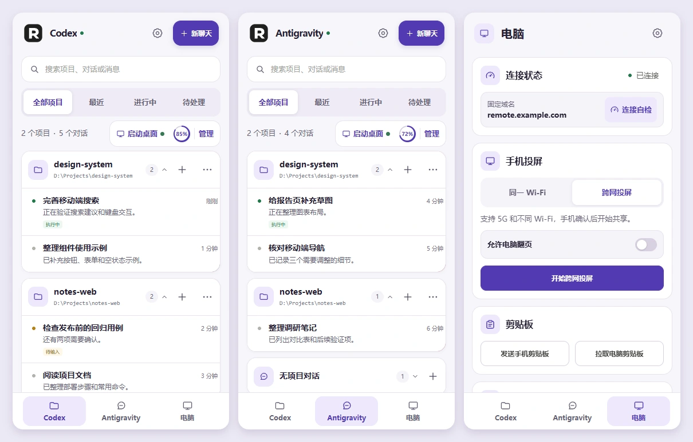

# Codex Remote for Android

**在 Android 上继续 Windows 上的 Codex 和 Antigravity 对话。** 出门后可以看任务进度、回复提问、补发截图，也可以直接发起新任务。助手在电脑上执行，沿用你已经登录的账号。

[下载 APK 和 Windows 配套服务](https://github.com/jujubon/codex-remote-android/releases/latest) · [快速开始](#快速开始) · [异地连接](#异地连接使用-cloudflare-tunnel)

| 页面 | 你可以在手机上做什么 |
| --- | --- |
| **Codex** | 浏览电脑上的项目和对话，发起新任务，查看工具执行过程和剩余额度。在支持的会话里答复提问、处理审批、引导或停止当前轮。 |
| **Antigravity** | 用电脑上已登录的 CLI 新建和继续对话、查看额度。需要接手桌面对话时，从「启动桌面」进入 Google 官方远程面板。 |
| **电脑** | 自检连接、互传文件和剪贴板、锁屏或熄屏挂机，从手机收件箱预览图片，也可控制手机阅读窗和安装更新。 |

<p align="center">
  
</p>

## 快速开始

准备一部 **Android 7.0 或以上**的手机和一台已安装并登录 **Codex Desktop** 的 Windows 电脑。

1. **安装两端。** 手机上安装 APK，Windows 上把 ZIP 完整解压到固定目录。[下载最新版](https://github.com/jujubon/codex-remote-android/releases/latest)
2. **同一 Wi-Fi 下启动服务。** 双击解压目录里的 `Start.cmd`，窗口会显示 `App address` 和 `Pairing token`。
3. **在手机配对。** 打开「连接设置」，分别填入服务器地址和配对令牌，点「保存并连接」。打开已有对话或点「新聊天」即可。

Windows 启动器优先使用 Codex 附带的 Node.js。提示找不到 `node.exe` 时，可安装 Node.js 22.12 或以上再启动。Antigravity 的 CLI 对话需要在 Windows 上安装并登录 Antigravity CLI，手机发任务时会自动启动 CLI。

## 异地连接使用 Cloudflare Tunnel

本项目日常跨网使用 **Cloudflare Tunnel + 固定 HTTPS 域名**。电脑保持联网、唤醒并登录 Windows，手机切到移动数据后也能连接。

1. **在 Windows 启动隧道模式。** 先退出前台运行的 `Start.cmd`，再双击 `Start-Tunnel.cmd`，配套服务会监听 `http://127.0.0.1:8787`。
2. **配置 Cloudflare。** 先将你的域名添加到 Cloudflare，再在控制台创建 Tunnel，按 Windows 安装指引启动 `cloudflared`。为隧道添加一个公开子域名，服务地址设为 `http://127.0.0.1:8787`。[Cloudflare Tunnel 官方设置指南](https://developers.cloudflare.com/tunnel/get-started/)
3. **在手机使用固定地址。** 在「连接设置」把服务器地址改成你的 HTTPS 域名，例如 `https://remote.example.com`，配对继续使用 Codex Remote 生成的令牌。可切到移动数据，在「电脑 → 连接状态」做一次连接自检。

### 回到 Wi-Fi 时自动直连

把电脑上的可信 Wi-Fi 或手机热点设为 Windows「专用网络」，再以管理员身份运行一次 `Enable-Trusted-LAN.cmd`，然后重启 Windows 配套服务。手机保留固定 HTTPS 域名，找到并验证同一网络上的电脑后会自动直连，切回移动数据时再使用固定域名。

想手动验证局域网，可在手机的「手动局域网地址」填写 `http://<电脑的局域网 IPv4>:18788`。连接成功后，「电脑」页会显示「局域网直连」。热点的发现和可达性取决于 Android 与 Windows 的网络设置。[手机热点和阅读窗说明](docs/phone-reader.md#手机开热点给电脑)

## 常用操作

- **离开电脑后继续任务。** 手机上可以搜索项目、对话和消息。点「用时」展开执行过程，向上翻历史时暂停自动跟随，点「回到最新」继续看。已有桌面对话的实时操作取决于 Codex Desktop 的本地连接能力和会话状态。[桌面连接说明](docs/desktop-ipc.md)
- **启动或关闭两位助手的桌面。** 在各自的页面点「启动桌面」。绿点表示窗口已打开，橙点表示正在启停。Antigravity 的「进入桌面对话」需要在桌面设置中启用 Remote Control，并在官方面板使用同一 Google 账号。
- **发截图和文件。** 从 Android 分享菜单选「发送到电脑」，或在聊天输入框添加多个附件。图片可在手机收件箱预览。文件接收位置和附件清理可分别配置。[文件传输说明](docs/file-transfer.md)
- **用电脑看手机。** 在「电脑 → 手机投屏」选择本地 Wi-Fi 或跨网方式。本地投屏需配对 scrcpy，跨网共享由 Android 确认。电脑端翻页的权限和步骤见阅读窗说明。[手机阅读窗说明](docs/phone-reader.md)

## 后台运行与更新

- **Windows 登录后可用。** 第一次连通后，可以双击 `Enable-Autostart.cmd` 启用登录自启，由计划任务在后台启动配套服务。已单独安装的 Cloudflare 连接器由其服务运行，已配置为 Codex Remote 托管的隧道由计划任务一起启动。`Disable-Autostart.cmd` 可停用配套服务的登录自启。
- **手机冷启动时静默检查。** 发现新版时可选「立即更新」或「稍后再说」，也能从「电脑 → 版本与更新」主动检查。App 下载并校验 APK 后，由 Android 确认安装。
- **Windows 可用同一个入口更新。** 0.9.47 或更新版的后台守护程序会下载并校验 Windows ZIP、切换版本，启动失败时恢复旧版本。配对令牌继续使用，切换期间手机会短暂重连。手动运行或更早安装的 Windows 配套服务可以下载 ZIP，解压后从新版目录启动。[发布记录](docs/releases.md)

### 连不上时先查这三项

| 现象 | 检查方式 |
| --- | --- |
| 同一 Wi-Fi 连不上 | 核对电脑窗口里的 `App address`。如果只显示 `127.0.0.1`，请切回同网的 `Start.cmd` 模式，或通过固定域名连入。 |
| 固定域名连不上 | 看 Cloudflare 控制台的隧道是否在线，再检查 Windows 配套服务是否运行。用浏览器访问你的域名加 `/health`，可查看服务是否响应。 |
| 域名可访问，App 仍离线 | 核对手机填的是 Codex Remote 的配对令牌，再运行手机的连接自检，查看同步请求是否能收到回执。 |

<details>
<summary>自定义文件保存位置</summary>

在 Windows 的 `%LOCALAPPDATA%\CodexMobileRemote\device-tools.json` 配置手机分享目录与聊天附件目录。请选择支持硬链接的本地文件系统，例如 NTFS。更改聊天附件目录后需重启配套服务。

```json
{
  "receiveFolder": "D:\\PhoneDrop\\手机分享",
  "chatAttachmentFolder": "D:\\PhoneDrop\\Codex 对话附件",
  "autoOpen": false
}
```

</details>

## 从源码构建

在 Windows PowerShell 中运行。需要 Git、Git LFS、Node.js 22.12+、JDK 21 和 Android SDK Platform 36。Android 构建使用 `JAVA_HOME` 和 `ANDROID_HOME`。

```powershell
git clone https://github.com/jujubon/codex-remote-android.git
cd codex-remote-android
git lfs pull
npm.cmd ci
npm.cmd run build
npm.cmd test
```

构建 Android 调试包可运行 `npm.cmd run android:apk -w @codex-mobile/mobile`。调试 APK 使用本机签名，覆盖安装需要与已安装包的签名一致。打包 Windows ZIP 时，准备包含 `python.exe` 的 Python 3.13 Windows x64 嵌入式分发包，再运行下面的命令。

```powershell
.\windows\Package-Host.ps1 -PythonDirectory 'C:\tools\python-embed'
```

## 来源与许可证

Codex Remote 是社区项目，基于 CodexRemote 开发，Windows 原生对话适配复用了 Codex-QQ 的部分实现。项目使用 MIT 许可证。[CodexRemote](https://github.com/qy1603429908/CodexRemote) · [Codex-QQ](https://github.com/IIMovoMII/Codex-QQ) · [MIT 许可证](LICENSE) · [Windows 适配层许可证](apps/server/windows/native/LICENSE)
